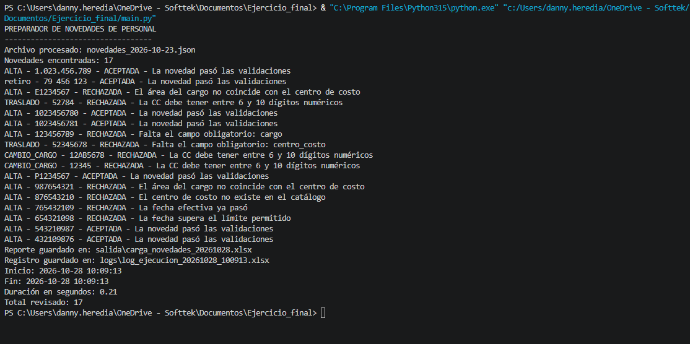
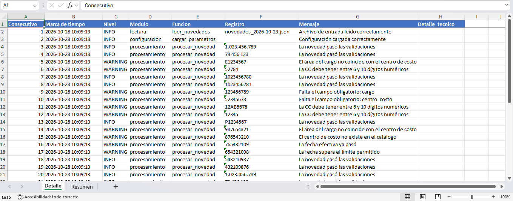
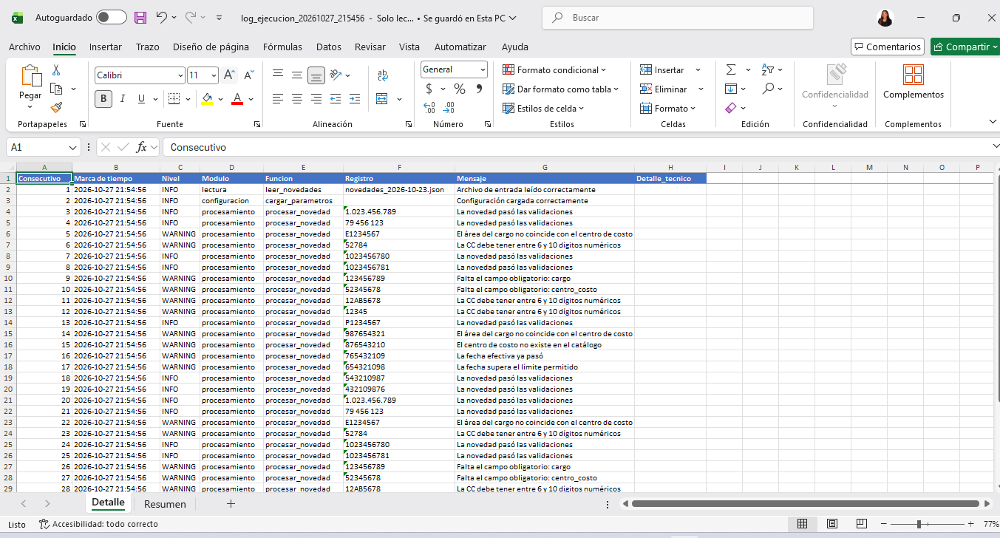
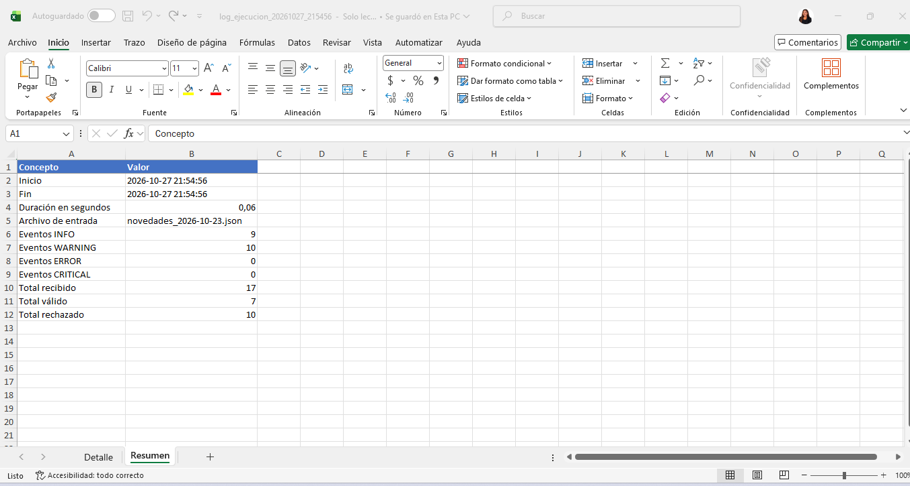
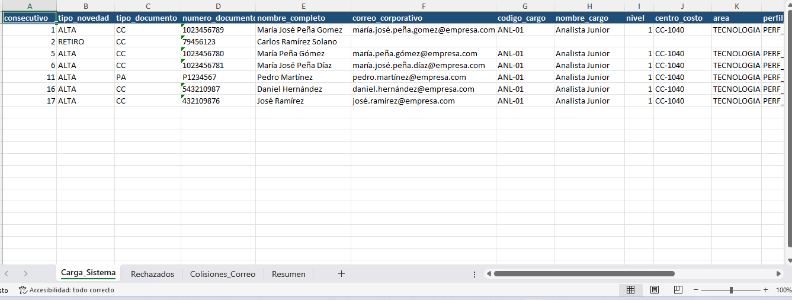
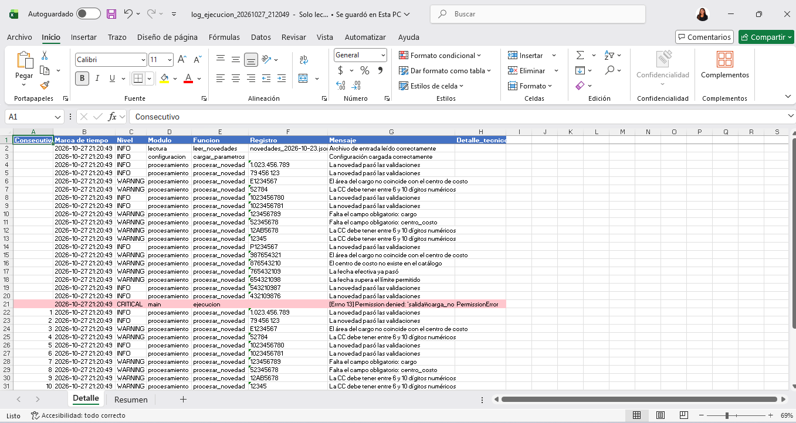

# Preparador de carga masiva de novedades de personal

## 1. Descripción del proyecto

Este proyecto consiste en un programa que ayuda a revisar novedades de personal para preparar la información antes de cargarla a un sistema.

El programa lee los datos de un archivo JSON y los compara con la información que se encuentra en un archivo de Excel. Después, revisa si los datos están correctos y separa las novedades que cumplen las condiciones de las que presentan errores.

Al finalizar, genera un archivo de Excel con los resultados y un registro de la ejecución.

## 2. Requisitos para ejecutar el programa

Para utilizar el programa se necesita:

- Tener Python 3 instalado.
- Tener las librerías necesarias.
- Contar con el archivo de configuración `Parametros.xlsx`.
- Tener un archivo JSON con las novedades que se van a revisar.

Para instalar las librerías utilizadas, se puede ejecutar el siguiente comando en la terminal:

```bash
pip install openpyxl pandas
```

## 3. Cómo ejecutar el programa

Para ejecutar el proyecto, se deben seguir estos pasos:

1. Abrir la carpeta del proyecto.
2. Verificar que el archivo de configuración esté en la carpeta `config`.
3. Colocar el archivo JSON en la carpeta `entrada`.
4. Abrir una terminal en la carpeta principal del proyecto.
5. Ejecutar el siguiente comando:

   ```bash
   python main.py
   ```

6. Revisar los resultados que se generan en la carpeta `salida` y los registros que se guardan en `logs`.

## 4. Estructura del proyecto

El proyecto está organizado en diferentes carpetas y archivos para mantener separada cada parte del programa.

- `main.py`: inicia y coordina el proceso.
- `config/`: contiene el archivo de configuración en Excel.
- `entrada/`: guarda los archivos JSON que se van a procesar.
- `salida/`: guarda el archivo Excel con los resultados.
- `logs/`: guarda los registros de la ejecución.
- `modulos/configuracion.py`: lee la configuración.
- `modulos/lectura.py`: busca y lee el archivo JSON.
- `modulos/validacion.py`: revisa los datos de las novedades.
- `modulos/procesamiento.py`: organiza la información y aplica las reglas del proceso.
- `modulos/reporte.py`: genera el archivo de resultados.
- `modulos/registro.py`: guarda el registro de la ejecución.
- `modulos/excepciones.py`: contiene los errores definidos para el proyecto.

## 5. Archivo de configuración

El archivo `Parametros.xlsx` contiene cinco hojas que ayudan a revisar la información:

- **Parametros:** contiene valores generales para las validaciones.
- **Cargos:** contiene la información de los cargos.
- **Centros_Costo:** contiene los centros de costo y sus áreas.
- **Matriz_Roles:** relaciona los cargos y las áreas con los perfiles correspondientes.
- **Campos_Obligatorios:** indica los campos que se deben completar según el tipo de novedad.

Esta configuración permite utilizar la información de Excel para realizar diferentes validaciones.


## 6. Reglas de validación implementadas

El programa revisa los datos de las novedades de personal antes de procesarlos.

| Validación | Expresión regular o condición | Mensaje de rechazo |
|---|---|---|
| Tipo de novedad | Debe estar registrado en el Excel. | El tipo de novedad no es válido |
| Campos obligatorios | Se consultan en la configuración de Excel. | Falta el campo obligatorio: nombre del campo |
| Documento CC | `^[0-9]{6,10}$` | La CC debe tener entre 6 y 10 dígitos numéricos |
| Documento CE | `^[0-9]{6,10}$` o `^[A-Z][0-9]{6,9}$` | La CE no cumple el formato permitido |
| Pasaporte (PA) | `^(?=.*[A-Z])[A-Z0-9]{6,12}$` | El PA debe tener entre 6 y 12 caracteres y al menos una letra |
| Fecha efectiva | `DD/MM/AAAA` o `AAAA-MM-DD` | La fecha no tiene un formato válido |
| Fecha vencida | La fecha no puede ser anterior al día actual. | La fecha efectiva ya pasó |
| Fecha futura | No debe superar el límite configurado. | La fecha supera el límite permitido |
| Centro de costo | `^CC-[0-9]{4}$` | El centro de costo no tiene el formato CC-0000 |
| Centro de costo inexistente | Debe existir en el catálogo de Excel. | El centro de costo no existe en el catálogo |
| Teléfono | Debe tener la cantidad de dígitos configurada. | El teléfono debe tener la cantidad de dígitos configurada |
| Correo electrónico | Debe cumplir el formato establecido. | El correo electrónico no tiene un formato válido |
| Cargo inexistente | Debe existir en el catálogo de cargos. | El cargo no existe en el catálogo |
| Área del cargo | Debe coincidir con el área del centro de costo. | El área del cargo no coincide con el centro de costo |
| Matriz de roles | El cargo y el área deben estar permitidos. | El cargo y el área no están permitidos |

## 7. Proceso del programa

El funcionamiento general del programa es el siguiente:

1. Se lee el archivo JSON y el archivo de configuración.
2. Se revisa cada novedad.
3. Se comprueban los datos y los campos obligatorios.
4. Se aplican las validaciones correspondientes.
5. Se separan las novedades aceptadas de las rechazadas.
6. Se genera el archivo Excel con los resultados.
7. Se guarda el registro de la ejecución.

## 8. Manejo de errores

El proyecto cuenta con diferentes tipos de excepciones para identificar problemas que pueden ocurrir durante el proceso.

- `ErrorProyecto`: error general del proyecto.
- `ErrorConfiguracion`: problema con la configuración.
- `ErrorArchivoEntrada`: problema al encontrar o leer el archivo de entrada.
- `RegistroInvalido`: novedad que no cumple las validaciones.
- `ErrorReglaNegocio`: problema relacionado con las reglas del negocio.
- `ErrorEscritura`: problema al guardar los archivos.

Estas excepciones permiten identificar diferentes situaciones que pueden presentarse durante la ejecución.

## 9. Evidencias del proyecto

### 9.1. Ejecución del programa

En esta imagen se muestra la ejecución del programa.



### 9.2. Registro de la ejecución

Las siguientes imágenes muestran el registro generado durante el proceso y sus diferentes hojas.

**Registro de ejecución:**



**Detalle del registro:**



**Resumen del registro:**



### 9.3. Resultado en Excel

En esta imagen se muestra el archivo Excel generado con los resultados del procesamiento de las novedades.



### 9.4. Ejecución con error

En esta imagen se muestra una ejecución en la que el programa presentó un error.



## 10. Dificultades encontradas

Durante el desarrollo y las pruebas fue necesario revisar los datos de las novedades para identificar cuáles cumplían las condiciones y cuáles presentaban errores.

También fue importante organizar el proyecto por módulos, utilizar el archivo de configuración y generar los reportes para consultar los resultados del proceso.

## 11. Conclusión

Con este proyecto pude trabajar en la lectura de archivos JSON, la validación de información, el manejo de errores y la generación de reportes en Excel.

El programa permite organizar las novedades de personal y diferenciar los registros que cumplen las condiciones de aquellos que necesitan revisión antes de continuar con el proceso.